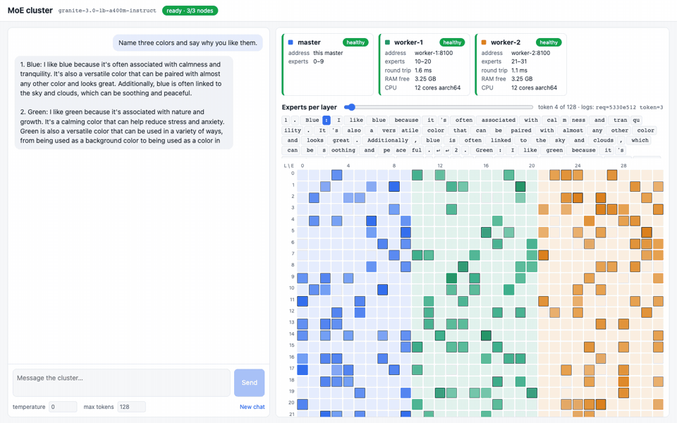

# Distributed MoE Inference

**Run one AI language model across several ordinary laptops, by giving each laptop its own share of the
model's "experts".** No graphics cards, just normal processors (CPUs) on the same Wi-Fi.



*The web page that comes with the cluster. On the left you chat. On the right, every square is one expert in
one layer, coloured by the laptop that holds it, and lighting up when it's used for the current token. When a
laptop disappears, the page shows exactly which experts are missing.*

---

## What is this, and what problem does it solve?

A language model is too big for a small laptop. A laptop with 8 GB of memory can't hold a 28 GB model, but
three laptops together can.

Most models can't easily be split between computers, but one kind can: **Mixture-of-Experts (MoE)** models.
In each layer of an MoE model, a small part called the **router** looks at every token (a word or piece of a
word) and picks only a few **experts** (small blocks of maths, e.g. 8 out of 32) to work on it. The other
experts do nothing for that token. And about **90 % of the model's size is experts**.

So the idea is:

- **The master** (one laptop) runs everything that isn't an expert: the router, attention and its memory of
  earlier tokens (the "KV cache"), and turning text into tokens and back. It's also where you chat.
- **The workers** (the other laptops) each hold some of the experts. For every layer of every token, the
  master sends them "run experts 3 and 17 on these numbers", and they send back the result.
- **Nobody holds the whole model.** Each laptop only needs memory for its own share.

Existing tools don't do this. llama.cpp/Ollama can split a model across computers, but only **by layers**,
not by experts. vLLM's multi-computer support is built for graphics cards in data centres. So the
expert-splitting is our own code, built on **PyTorch** and **Hugging Face Transformers**. We replace exactly
one line in each MoE layer (where Transformers calls the experts) and leave the rest of the model untouched.
The answers are **checked token by token** against the unchanged model.

From the outside it looks like any other model server: the master speaks the **OpenAI-style chat API**
(`/v1/chat/completions`, with streaming). So chat apps made for OpenAI, Ollama or vLLM, such as
[Open WebUI](https://github.com/open-webui/open-webui) or the `openai` Python package, work with it unchanged.

This is mainly a **learning and demo project**: seeing the work move between machines matters more than raw
speed. Every extra laptop adds a Wi-Fi round trip in every layer, so it's slower than one laptop running the
model alone. That's the price of the idea.

### What it can do today

- Split a model across a master and **any number of workers** (one, two or ten). They join by themselves.
- Give **exactly** the same answers as plain Transformers on the same kind of computer.
- Notice when a worker is slow, dies or comes back, and refuse chat requests while experts are missing.
- **Show it working:** logs that follow one token across every laptop, and the live web page above.
- Set up a new laptop with four commands, or with an AI agent from one sentence.

---

## Two ways to run it

| | **Docker on one computer** | **Across several laptops** |
|---|---|---|
| What it is | 1 master + 2 workers as three containers (small sealed Linux computers) on one machine | One master laptop and any number of worker laptops on the same Wi-Fi, running natively (no Docker) |
| Good for | Trying it out, development, running the tests | The real thing: experts truly on different machines |
| Speed | Slow on a Mac (Docker runs in a hidden virtual machine there) | Decided mostly by the Wi-Fi |
| Guide | [docs/DOCKER_SETUP.md](docs/DOCKER_SETUP.md) | [docs/LAPTOP_SETUP.md](docs/LAPTOP_SETUP.md) |

### Quick start: Docker on one computer

You need [Docker Desktop](https://www.docker.com/products/docker-desktop/).

```bash
git clone git@github.com:umar1997/distributed-inferencing.git
cd distributed-inferencing
docker compose -f docker/docker-compose.yml up --build -d   # first time: builds the image, downloads the model
```

Then open **http://localhost:8000**. Stop it with `docker compose -f docker/docker-compose.yml down`.

### Quick start: across laptops

You need **Python 3.12** and **git** on every laptop, and **Node.js** on the master (for the web page). Put
all laptops on the **same Wi-Fi**. Set up the master first, because a worker's setup asks the master which
experts are still free.

```bash
# on every laptop, once
git clone git@github.com:umar1997/distributed-inferencing.git
cd distributed-inferencing
./scripts/install.sh      # creates a private Python environment (.venv) and installs everything
./moe setup               # asks a few questions, checks the answers, saves them to node.env

# then, every time
./moe serve               # on the master (start it first)
./moe join                # on each worker
./moe status              # on any laptop: who's connected, and do they hold all the experts?
```

`./moe setup` asks whether the laptop is the master or a worker. On the master it makes a **cluster token**
(a shared password) and suggests how to split the experts. On a worker you type the master's address and the
token, and it checks that it can reach the master, that the token is right, which experts are still free, and
that they fit in this laptop's memory. Your answers are saved in `node.env`, so later starts ask nothing.

The full step-by-step guide, with separate sections for the master and a worker, "first time" and "every time
after", example values for 2, 3 and 4 laptops, and a problems-and-fixes table, is
**[docs/LAPTOP_SETUP.md](docs/LAPTOP_SETUP.md)**.

### Or let an AI agent set up the laptop

On the new laptop, clone the repo, open [Claude Code](https://claude.com/claude-code) (or another coding
agent) in the repo folder, and say:

> **Read docs/LAPTOP_HANDOFF.md and set up this laptop.**

[docs/LAPTOP_HANDOFF.md](docs/LAPTOP_HANDOFF.md) is written to the agent. It checks what's installed, asks you
only what it can't find out itself (master or worker, the master's address, the token, how many laptops),
installs, runs the setup, and reports back in plain English. It doesn't change any code, and it never prints
the token in its summary.

---

## The models

| Model | Size (bf16) | Experts per layer | Used per token | Layers | Status |
|---|---|---|---|---|---|
| [IBM Granite 3.0 1B-A400M Instruct](https://huggingface.co/ibm-granite/granite-3.0-1b-a400m-instruct) | 2.7 GB | 32 | 8 | 24 | **Works now** |
| [Qwen1.5-MoE-A2.7B Chat](https://huggingface.co/Qwen/Qwen1.5-MoE-A2.7B-Chat) | 28.6 GB | 60 | 4 | 24 | Next (needs its own adapter) |
| [Qwen3-30B-A3B Instruct](https://huggingface.co/Qwen/Qwen3-30B-A3B-Instruct-2507) | 61 GB | 128 | 8 | 48 | Stretch goal |

**bf16** is the number format: 2 bytes per number, the format the models are published in.

**Granite** is the test model: small, quick to download, and a real MoE model with the same structure as the big
ones. Its answers aren't very clever. **Qwen1.5-MoE** is the real target: much better answers, and it fits across two or
three of our 36 GB Macs. **Qwen3-30B** needs all three. Each model family stores its experts differently
in its files, so each one needs a small **adapter**, a piece of code that knows that model's file layout. Only
Granite's is written so far. Full details are in [docs/AVAILABLE_MODELS.md](docs/AVAILABLE_MODELS.md).

---

## The laptops we test on

All three laptops are the same kind of Mac:

| Laptop | Memory | Processor / system | Role |
|---|---|---|---|
| Laptop A (Mac) | 36 GB | Apple Silicon, macOS | Worker |
| Laptop B (Mac) | 36 GB | Apple Silicon, macOS | Development machine, then the master |
| Laptop C (Mac) | 36 GB | Apple Silicon, macOS | Worker |

**What's been run so far:**

- **One program on one Mac:** about 16.5 tokens per second, with answers identical to plain Transformers.
- **Docker, 3 containers on Laptop B:** about 1.8 tokens per second, slowed down by Docker's hidden
  virtual machine on macOS, not by the network. Answers identical to plain Transformers running on Linux. Each
  container also stays inside an 8 GB laptop's memory budget.
- **Two real laptops over Wi-Fi, no Docker:** Laptop B as master (experts 0–15) and a second Mac as
  worker (experts 16–31). The master reached the worker in about 21 ms typically (132 ms at the slowest 5 %),
  and the web page worked from both. Speed measurements over Wi-Fi are next.

The full story, including what went wrong and how it was fixed, is in [docs/STORY.md](docs/STORY.md).

---

## Folder structure

```
distributed-inferencing/
├── moe                       # the one command on every laptop: setup, serve, join, status, leave, download
├── moe_dist/                 # the Python code
│   ├── cli/                  #   the ./moe commands, and the setup questions (setup.py)
│   ├── master/               #   the master: loads everything except the experts, chat API, live events
│   ├── worker/               #   a worker: holds its experts, registers with the master, heartbeats
│   ├── experts/              #   cutting experts out of the model file, running them, the dispatcher
│   ├── transport/            #   sending numbers between laptops quickly (HTTP + a compact binary format)
│   ├── models/               #   one adapter per model family (Granite so far) and the model list
│   ├── config.py             #   every setting, read from node.env or environment variables
│   └── logs.py               #   one log format on every node, labelled by request, token and layer
├── ui/                       # the web page (React); built by install.sh, served by the master
├── tests/                    # quick tests, plus slower ones that load the model or start a cluster
│   └── golden/               #   reference answers from the unchanged model, to compare against
├── scripts/
│   ├── install.sh            #   one-time install on a laptop
│   ├── make_golden.py        #   makes the reference answers
│   ├── benchmark.py          #   measures speed
│   └── memory_check.py       #   checks the 8 GB memory budget
├── docker/                   # the Docker image and the 3-container setup
├── docs/                     # all the documentation (see below)
├── node.env.example          # a sample settings file, for setting up by hand
├── requirements.txt          # exact Python package versions, the same on every laptop
└── pipeline-parallel-prototype/  # an older, separate experiment: a model split by layers across 2 GPU machines
```

## Documentation

| File | What's in it |
|---|---|
| [docs/STORY.md](docs/STORY.md) | The story of the project in plain English: the idea, every decision and why, what went wrong |
| [docs/PLAN.md](docs/PLAN.md) | What we set out to build |
| [docs/IMPLEMENTATION.md](docs/IMPLEMENTATION.md) | The phase-by-phase plan, every setting, the internal APIs, and the results of each phase |
| [docs/AVAILABLE_MODELS.md](docs/AVAILABLE_MODELS.md) | The models: sizes, memory, how their experts are stored |
| [docs/DOCKER_SETUP.md](docs/DOCKER_SETUP.md) | Running the cluster in Docker on one computer; running the tests |
| [docs/LAPTOP_SETUP.md](docs/LAPTOP_SETUP.md) | Running the cluster across laptops, step by step |
| [docs/LAPTOP_HANDOFF.md](docs/LAPTOP_HANDOFF.md) | Instructions for an AI agent that sets up a laptop |

---

## Tests

```bash
./scripts/install.sh                                         # once
.venv/bin/python -m pytest -q -m "not model and not cluster"   # quick tests, no model needed
.venv/bin/python -m pytest -q -m model                         # loads the model and checks answers token by token
```

More in [docs/DOCKER_SETUP.md, section 6](docs/DOCKER_SETUP.md#6-working-on-the-code-tests-and-reference-answers).

---

## Licensing

- **This repository's code** is under the [MIT License](LICENSE): free to use, change and share, including
  commercially, as long as the copyright notice stays with it. It comes with no warranty.
- **The models are not part of this repo.** They're downloaded from Hugging Face, and each has its own
  license:
  - IBM Granite 3.0 and Qwen3-30B-A3B: [Apache 2.0](https://www.apache.org/licenses/LICENSE-2.0) (free to
    use, change and share, including commercially).
  - Qwen1.5-MoE-A2.7B: the [Tongyi Qianwen license](https://huggingface.co/Qwen/Qwen1.5-MoE-A2.7B-Chat/blob/main/LICENSE)
    (free for personal and research use; large commercial use needs permission).
- **Main libraries:** PyTorch (BSD), Hugging Face Transformers (Apache 2.0), FastAPI (MIT), React (MIT).

---

## Acknowledgements

Built on [PyTorch](https://pytorch.org) and [Hugging Face Transformers](https://github.com/huggingface/transformers),
with models from [IBM Granite](https://huggingface.co/ibm-granite) and [Qwen](https://huggingface.co/Qwen). The
health checks between master and workers follow the style of [FastChat](https://github.com/lm-sys/FastChat).
