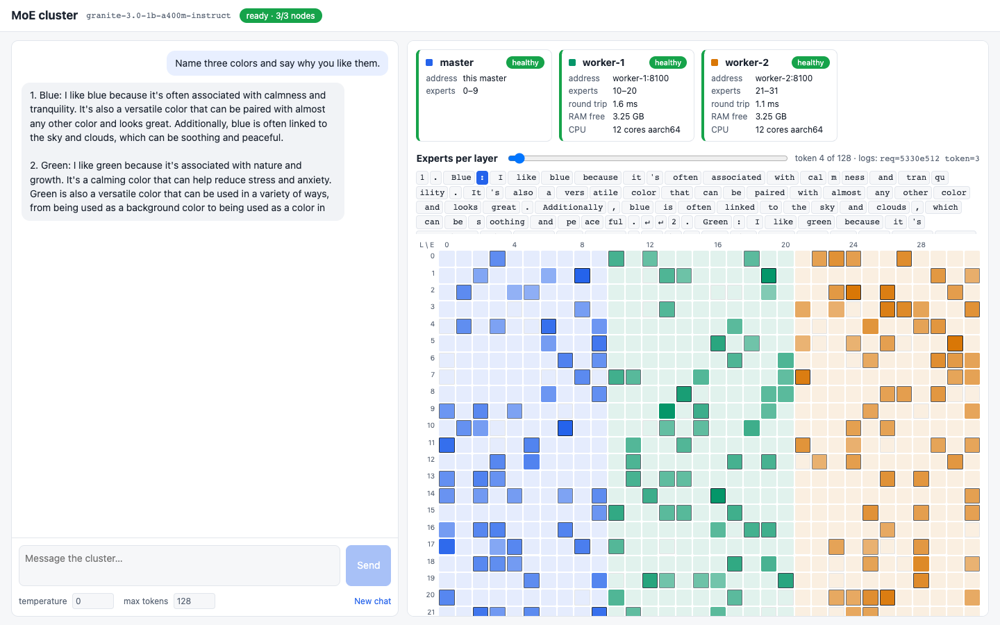

# Implementation Plan

This is the step-by-step build plan for the system described in [PLAN.md](PLAN.md). The models, their sizes and the order we use them in are in [AVAILABLE_MODELS.md](AVAILABLE_MODELS.md).

**Model order:** Granite (`ibm-granite/granite-3.0-1b-a400m-instruct`) for all four steps, then Qwen1.5-MoE (`Qwen/Qwen1.5-MoE-A2.7B-Chat`) on the real laptops, then Qwen3-30B-A3B as a stretch goal.

---

## 0. The big idea in one paragraph

We **do not rewrite the model**. We load the normal Hugging Face model on the master, but every MoE layer has one line, `self.experts(hidden_states, top_k_index, top_k_weights)`, that does the expert work (checked in Transformers 5.20.1 for Granite, Qwen1.5-MoE and Qwen3-MoE). We replace that `experts` object with our own **dispatcher**. The dispatcher has the same inputs and outputs, but sends each expert's work to whichever node holds that expert and puts the answers back together. Attention, the router, the KV cache, the chat template and token sampling all stay as Transformers' own tested code. Workers are **stateless**: they only hold expert weights and turn the numbers they receive into answers. They remember nothing between calls.

---

## 1. Answers to the questions in PLAN.md section 17

### Q1. HTTP + JSON, HTTP + binary, or gRPC?

**Recommendation: HTTP with a binary body, over connections that stay open.**

- **HTTP + JSON** is easy to read, but numbers become text. That is slower, bigger, and can lose a tiny bit of precision, which breaks the "same tokens" test.
- **HTTP + binary:** the request is a small JSON header (request ID, layer, shapes) followed by the raw tensor bytes. Still easy to debug (the header is readable and logged), exact, and fast.
- **gRPC** is a framework with typed messages and its own tools. It is a bit faster per call, but it adds code generation, a second server type and harder debugging. Our data is tiny (2–4 KB per token per layer); **Wi-Fi delay (3–10 ms) is far bigger than any difference between HTTP and gRPC (well under 1 ms)**. Not worth it for a learning project.
- **Connections that stay open ("keep-alive")**: the master opens one connection to each worker and reuses it, so no time is lost setting up a new connection on every call.

### Q2. One copy of each expert, or backup copies?

**Start with exactly one copy.** It is simpler and the memory math is clear. Because workers are stateless, backups are easy to add later (Phase 4.4): the placement map simply allows more than one node per expert, and the dispatcher picks one. Backups also let the master pick the *faster* node.

### Q3. Send work per token, or group it per layer?

**Group per layer: one message per node per layer.** For each layer, the master collects all the work for node X (all tokens, all of X's picked experts) into **one** request and sends all nodes their requests **at the same time**.

- **While reading the prompt** (called "prefill", all prompt tokens at once), this matters a lot: a 200-token prompt becomes 1 call per node per layer, not 200.
- **While generating** (one new token at a time, called "decode") there is only one token anyway, so it is already one call per node per layer.

On a home network the number of round trips decides the speed, so this rule matters.

### Q4. fp32, bf16 or int8 on CPU?

- **fp32** — most exact, works everywhere. **Use it for correctness tests** (it removes rounding noise). Granite in fp32 is 5.3 GB, fine on the 36 GB Mac.
- **bf16** — half the memory. This is what the models ship in. It works in PyTorch on both ARM and x86, but its speed depends on the CPU (newer Apple and Intel/AMD chips have special bf16 instructions). **Use it as the normal setting.**
  *Decided after Phase 2.1:* bf16 results depend on the platform (macOS and Linux pick different tokens for 5 of 10 prompts, even with plain Transformers), while fp32 gave identical tokens on both. So across different machines: **fp32 must give identical tokens; bf16 must pass the near-tie rule** plus a check by hand. bf16 stays the normal setting because Qwen1.5 (57 GB in fp32) only fits in bf16.
- **int8** — a quarter of fp32. PyTorch's ready-made int8 tools don't handle packed 3-D expert tensors, so it needs our own small code. **Only needed for the Qwen3-30B stretch goal.**

`DTYPE` is a setting; Phase 1 measures the real speed of fp32 vs bf16 on the Mac.

### Q5. What if one laptop is much slower?

At every layer the master waits for the slowest node, so one slow laptop slows everything down. In order of effort:

1. **Give the slow laptop fewer experts** (fewer experts → it is picked less often). This is already in the plan for the 8 GB laptop.
2. **Put the most-used experts on the master** (no network at all). Phase 4.3 measures which experts are picked most often and suggests a placement.
3. **Backup copies** (Phase 4.4) let the master send work to the faster copy.
4. Show "time spent waiting on each node" in the logs and UI, so the slow node is obvious.

### Q6. Where does the KV cache live?

**Confirmed: only on the master.** Only the master runs attention, and the KV cache is attention data. Workers only run experts, which have no memory of earlier tokens. This is a big win: **workers are stateless**, so a call to a worker can be safely repeated or sent to another worker that holds the same experts.

### Q7. Same expert numbers in every layer on a node — good idea?

**Yes, as the default.** Every slot costs the same memory, so the memory math is simple, and it is easy to read in the UI. But note: **expert 5 in layer 0 has nothing to do with expert 5 in layer 1**. They are unrelated networks; the numbers are just positions. So there is no speed benefit in keeping the same numbers.

**Plan:** the internal placement map is always "layer → expert → node(s)". `EXPERT_IDS=0-10` is a shortcut that fills the same numbers in every layer. Phase 4.3 adds an optional per-layer map file (`EXPERT_MAP`), needed for "put the most-used experts on the master", because the most-used experts differ from layer to layer.

### Q8. Mistakes or risks in the design (direct answers)

1. **Speed is limited by round trips, not by computing.** Granite has 24 MoE layers, so each new token needs 24 waits for the network. With ~5–10 ms Wi-Fi round trips, that is 120–240 ms per token, so **at most ~4–8 tokens per second**, however fast the CPUs are. Qwen3-30B has 48 layers, so half that. This isn't a mistake in the plan, it's the price of the design. Batching per layer and placing the most-used experts on the master are the main ways to reduce it.
2. **"Dead" must not be decided from one slow reply.** Wi-Fi spikes of 100–300 ms are normal. Use timeouts of several seconds, a retry before giving up, and "need 3 good replies in a row to become healthy again" (see section 5).
3. **A worker dying in the middle of a response:** **recommended rule: retry the call once on the same node; if it fails, send it to a backup copy if one exists; otherwise stop the response with a clear error** ("worker-2 stopped responding; experts [3, 7] in layer 6 are unavailable"). Workers are stateless, so retrying cannot give a wrong answer. Never silently skip experts: that would quietly produce worse text.
4. **The master must not load the full model** with plain `from_pretrained` once models get big, or it pays for all experts in memory for a moment. Plan: build the model "empty" and load only the shared parts + its own experts from the files (Phase 2.1). For Granite this doesn't matter yet, but building it the right way once saves a rewrite for Qwen.
5. **"Same model" must mean the same version.** Check the model ID **and** the pinned commit ID (`MODEL_REVISION`), plus the number format.
6. **Wi-Fi routers can block laptop-to-laptop traffic.** Some routers have "client isolation" / "AP isolation" turned on, especially on guest networks. Check this before Step 4 (section 8).
7. **Docker Desktop memory limit is one setting for all containers together** (it is the size of Docker's hidden Linux virtual machine). Per-container limits are set separately in `docker-compose.yml`. Both are needed.
8. **Live UI events every layer for every token** = hundreds of messages per second. Send **one event per token** with all its layers' routing inside, not one per layer.

---

## 2. Proposed folder structure

```
distributed-inferencing/
├── requirements.txt            # pinned dependency versions (install: docs/SETUP.md)
├── .venv/                      # local Python environment (git-ignored)
├── pyproject.toml              # later (Phase 4): `pip install` makes `moe-node` a command outside Docker
├── moe_dist/                   # all Python code
│   ├── config.py               # settings from environment variables (one place)
│   ├── serve.py                # `python -m moe_dist.serve`: start master or worker
│   ├── prepare.py              # one-time model download (Docker "prepare" step)
│   ├── logs.py                 # log format: pretty or JSON, request/token/layer fields
│   ├── models/                 # one small "adapter" per model family
│   │   ├── base.py             # what every adapter must provide
│   │   ├── granite.py          # file names, packed experts on disk
│   │   ├── qwen2_moe.py        # Qwen1.5: separate experts on disk, shared expert
│   │   └── qwen3_moe.py        # Qwen3 (stretch goal)
│   ├── experts/
│   │   ├── slicing.py          # cut experts out of packed tensors
│   │   ├── loader.py           # read only chosen experts from the weight files
│   │   ├── compute.py          # run experts on tokens (same math as Transformers)
│   │   ├── placement.py        # layer → expert → node(s) map, coverage check
│   │   └── dispatcher.py       # replaces model's `experts`; local or remote
│   ├── transport/
│   │   ├── codec.py            # pack/unpack tensors into the binary message format
│   │   └── client.py           # kept-open HTTP connections, parallel calls, retries
│   ├── master/
│   │   ├── app.py              # FastAPI app for the master
│   │   ├── model_loader.py     # load shared parts + own experts only
│   │   ├── engine.py           # runs generation, one request at a time, streaming
│   │   ├── generation.py       # one answer: sampling settings, stop texts, streaming, the waiting line
│   │   ├── controller.py       # node list, registration, health states
│   │   ├── openai_api.py       # /v1/chat/completions, /v1/models
│   │   └── events.py           # live events for the UI (Server-Sent Events)
│   ├── worker/
│   │   ├── app.py              # FastAPI app for a worker
│   │   └── membership.py       # register, heartbeat, re-register loop
│   └── cli/
│       └── main.py             # `moe-node serve | join | status | leave` (+ `netcheck` in 4.1)
├── ui/                         # React + Vite app (built into the image, served by the master at /)
│   └── src/
│       ├── api.ts              # live events + streaming chat
│       ├── pages/Chat.tsx
│       ├── pages/System.tsx
│       └── components/ (NodeMap, ExpertGrid with the live routing, Stats)
├── docker/
│   ├── Dockerfile              # one image for every node, multi-architecture
│   ├── certs/                  # optional extra certificates (company security filters)
│   ├── docker-compose.yml      # Step 2: 1 master + 2 workers on one laptop
│   └── docker-compose.8gb.yml  # same, with memory limits for the 8 GB check
├── tests/
│   ├── golden/                 # reference outputs per model (from plain Transformers)
│   ├── test_slicing.py
│   ├── test_loader.py
│   ├── test_compute.py
│   ├── test_codec.py
│   ├── test_placement.py
│   ├── test_equivalence.py     # "same tokens as Transformers"
│   ├── servers.py              # helper: real master/worker services in the test process
│   ├── test_remote.py          # real HTTP, no Docker
│   ├── test_controller.py      # health rules with a fake clock
│   ├── test_failures.py        # join / die / come back / leave, in the test process
│   ├── test_openai_api.py      # /v1 API with the official openai client
│   ├── test_cluster.py         # Step 2 tests against running containers
│   └── test_cluster_failures.py  # docker stop / pause / restart, network delay
├── scripts/
│   ├── make_golden.py          # create reference outputs for a model
│   ├── benchmark.py            # fixed prompts → tokens/sec, network time
│   ├── netcheck.py             # round-trip time between machines
│   ├── expert_usage.py         # which experts get picked most (Phase 4.3)
│   └── prompts.json            # the fixed test prompts
└── docs/
    ├── PLAN.md
    ├── AVAILABLE_MODELS.md
    ├── IMPLEMENTATION.md       # this file
    ├── SETUP.md                # Python environment, step by step
    └── NETWORK_SETUP.md        # written in Phase 4.1
```

---

## 3. Configuration (environment variables)

| Variable | Example | Used by | Meaning |
|---|---|---|---|
| `NODE_ROLE` | `master` / `worker` | all | What this container does |
| `NODE_ID` | `worker-1` | all | Unique name, appears in every log line |
| `MASTER_ADDR` | `192.168.1.10:8000` | worker | Where to register |
| `LISTEN_PORT` | `8000` / `8100` | all | Port inside the container |
| `ADVERTISE_ADDR` | `192.168.1.21:8100` | worker | Address others use to reach **this** node (laptop's LAN IP + published port). Default: `<NODE_ID>:<LISTEN_PORT>` |
| `REGISTER_RETRY_MAX_S` | `10` | worker | Longest wait between tries to reach the master (1, 2, 4 … this) |
| `EXPERT_IDS` | `0-10` or `0,4,8,12` | all | Experts held in every layer (`none` allowed on master) |
| `EXPERT_MAP` | `/config/placement.yaml` | all | Optional per-layer map (Phase 4.3); overrides `EXPERT_IDS` |
| `MODEL_ID` | `ibm-granite/granite-3.0-1b-a400m-instruct` | all | Hugging Face model |
| `MODEL_REVISION` | `ffec3c35…` | all | Pinned commit; must match on every node |
| `DTYPE` | `fp32` / `bf16` / `int8` | all | Number format |
| `MODEL_DIR` | `/models` | all | Where weights are stored (Docker volume) |
| `CLUSTER_TOKEN` | a long random string | all | Shared secret; every internal call must send it |
| `API_KEY` | optional | master | Optional key for the OpenAI-style API |
| `MAX_QUEUE` | `16` | master | Requests that may wait while one is answered; more get `429 busy` |
| `DEFAULT_MAX_TOKENS` | `512` | master | Answer length when a request does not set `max_tokens` |
| `COMBINE_MODE` | `exact` / `fast` | master | See section 4.2 |
| `HEARTBEAT_INTERVAL_S` | `2` | master | How often workers send "I'm alive" (the master tells each worker when it registers) |
| `PING_INTERVAL_S` | `3` | master | How often the master pings each worker |
| `PING_TIMEOUT_S` | `2` | master | A ping without answer after this long counts as failed |
| `SLOW_RTT_MS` | `250` | master | Typical round trip above this → `slow` |
| `DEAD_AFTER_S` | `15` | master | No successful contact for this long → `dead` |
| `RECOVER_AFTER_OK` | `3` | master | Good replies in a row needed to become `healthy` again |
| `EXPERT_CALL_TIMEOUT_S` | `5` | master | Timeout for one expert call during generation |
| `EXPERT_CALL_RETRIES` | `1` | master | Retries on the same node before failing over (only when the worker did not answer or said "not ready") |
| `TORCH_THREADS` | `4` / `2` | all | CPU threads for PyTorch (0 = all cores) |
| `LOG_FORMAT` | `pretty` / `json` | all | |
| `LOG_LEVEL` | `info` / `debug` | all | `debug` = one line per token per layer |

Command line (installed inside the image as `moe-node`):

- `moe-node serve` — start this node from the environment variables (what the container runs).
- `moe-node join --master 192.168.1.10:8000 --experts 0-15 [--advertise 192.168.1.21:8100]` — start a worker with these settings (overrides env vars).
- `moe-node status [--master …]` — table of nodes, their health, round-trip time and experts; plus "coverage: OK" or the list of missing experts.
- `moe-node leave` — tells the master this worker is leaving, then stops.
- `moe-node netcheck --target 192.168.1.21:8100` — measures round-trip times (Phase 4.1).

---

## 4. Internal APIs (master ↔ workers)

Every internal call sends the header `Authorization: Bearer <CLUSTER_TOKEN>`. A wrong or missing token gets `401` and is logged.

### 4.1 On the master

| Endpoint | Sent | Returned |
|---|---|---|
| `POST /internal/register` | `node_id`, `advertise_addr`, `model_id`, `model_revision`, `dtype`, `adapter_version`, `experts` (`{"all_layers": [10..20]}` or a per-layer map), `ram_total_gb`, `ram_free_gb`, `cpu_cores`, `cpu_arch`, `software_version` | `accepted: true`, `master_epoch`, `heartbeat_interval_s` — or `accepted: false` + `reason` (e.g. "model revision differs: you have abc…, cluster uses ffec…") |
| `POST /internal/heartbeat` | `node_id`, `master_epoch`, `ram_free_gb`, `busy`, `calls_served` | `ok: true` — or `ok: false, reregister: true` if the master doesn't know this node or the epoch is old |
| `POST /internal/leave` | `node_id` | `ok: true` |
| `GET /health` | — | `{status: "ok", role: "master", ready: true/false, missing_experts: N}` (also used by Docker) |
| `GET /api/nodes` | — | All nodes: id, address, status, last heartbeat, round-trip p50/p95, RAM, CPU, experts held |
| `GET /api/placement` | — | Layer × expert → node(s), and coverage result |
| `GET /api/events` | — | **Server-Sent Events** stream for the UI (see Phase 3.2) |
| `POST /v1/chat/completions` | OpenAI format, `stream: true/false` | OpenAI format; streaming uses SSE `data: {…}` chunks and ends with `data: [DONE]` |
| `GET /v1/models` | — | The one loaded model, OpenAI format |

**`master_epoch`** is a random ID the master picks every time it starts. If a worker sees a different epoch in a heartbeat reply, or its heartbeats fail and later succeed, it knows the master restarted and registers again.

### 4.2 On each worker

| Endpoint | Sent | Returned |
|---|---|---|
| `POST /internal/expert/forward` | Binary message (below) | Binary message (below) |
| `GET /health` | — | `{status, node_id, model_id, model_revision, experts, uptime_s, ready}` |
| `POST /internal/ping` | `{sent_at}` + optional padding bytes (for netcheck) | `{sent_at, worker_time}` |

**Binary message format** (`Content-Type: application/x-moe-tensors`):

```
[4 bytes: header length N][N bytes: JSON header][tensor 1 bytes][tensor 2 bytes]...
```

The JSON header names each tensor with its type, shape and position. Tensors are raw little-endian bytes. This is small, exact and easy to inspect: the header is logged as-is at `debug` level.

**Forward request** header:
```json
{"request_id": "a1b2", "token_index": 14, "layer": 6, "combine_mode": "exact",
 "tensors": [
   {"name": "hidden",   "dtype": "bf16",  "shape": [1, 1024]},
   {"name": "row",      "dtype": "int32", "shape": [3]},
   {"name": "expert",   "dtype": "int32", "shape": [3]},
   {"name": "weight",   "dtype": "bf16",  "shape": [3]}]}
```
- `hidden`: only the tokens that need at least one of this worker's experts (one row per token).
- `row`, `expert`, `weight`: one entry per (token, expert) pair this worker must run: which row of `hidden`, which **global** expert number, and the router's weight for it. Lists are sorted by expert number; inside one expert, by choice rank (all tokens that picked it as their 1st choice, then 2nd choice, …) and then by row. This is exactly the order Transformers uses (`torch.where` on its expert mask); it matters because a different batch of rows can round differently (Phase 1.2). `hidden` keeps the batch order.

**Forward response** header: `{"node_id": "worker-1", "compute_ms": 4.1, "experts_run": [3, 7]}` plus one tensor:
- `COMBINE_MODE=exact`: `out` has **one row per (token, expert) pair**, already multiplied by its weight. The master adds them up **in exactly the order Transformers does** (expert 0, 1, 2, …). Additions in a computer give tiny different results in a different order, so this keeps the output **bit-for-bit identical** on one machine. Cost: up to 8 rows per token instead of 1 (16 KB instead of 2 KB for one Granite token), which is still small.
- `COMBINE_MODE=fast`: `out` has **one row per token**: the worker adds up its own experts first. Less data, but tokens can differ very rarely, at near-ties (see the matching rule in Phase 1.3).

Default: `exact` for Steps 1–2, measure both in Phase 4.3.

---

## 5. Health rules (FastChat-style, with two-way checks)

The ideas taken from FastChat's controller/worker design: workers register themselves; workers send heartbeats on a timer; the controller removes workers that stop sending heartbeats; the controller is the single source of truth for "who can do what". Our additions: the master also pings workers, there is a `slow` state, and workers re-register by themselves.

| State | Meaning | Becomes this when… |
|---|---|---|
| `joining` | Registered, still loading weights | Registration accepted, `ready=false` |
| `healthy` | Normal | `ready=true` and `RECOVER_AFTER_OK` good contacts in a row |
| `slow` | Answers, but late | Median of last 5 ping round trips > `SLOW_RTT_MS`, or a heartbeat is late by more than 2 intervals |
| `dead` | Not answering | No successful heartbeat **or** ping for `DEAD_AFTER_S`, or an expert call failed after retries |
| `left` | Said goodbye | Called `/internal/leave` |

- Every state change is **always** logged at `info`: `worker-2 status: healthy → dead (no contact for 15.2 s)`, and sent to the UI.
- A `slow` node is still used. Only `dead` / `left` nodes are excluded.
- **Coverage check:** before accepting a chat request, the master checks that every (layer, expert) pair has at least one `healthy`/`slow` node. If not, it answers `503` with `{"error": "missing experts", "missing": {"all_layers": [21, 22, …]}, "unavailable_nodes": {"worker-2": "dead"}}`.
- **Worker dies during a response:** retry once → backup copy if any → stop with a clear error (the reason is in section 1, Q8.3). The text streamed so far is kept, and the stream ends with an error message.
- **Dead worker comes back:** its heartbeats start working again; the master says "re-register", the worker registers, and after 3 good contacts it is `healthy`.
- **Master restarts:** workers see heartbeat failures, keep retrying (waiting 1, 2, 4… up to 10 s between tries), then see a new `master_epoch` and register again. Nothing to do by hand.

---

## 6. Phases

Each phase lists: **Goal**, **What gets built**, **Key decisions**, **How to test it**, **Done when**, **Risks**.

---

### Phase 0 — Project setup and reference outputs

**Goal:** a working Python environment on the 36 GB Mac, the Granite model downloaded, and "golden" reference outputs from plain, unchanged Transformers that every later step is compared to.

**What gets built:**
- `requirements.txt` (Python 3.12, pinned `torch`, `transformers==5.20.1`, `safetensors`, `fastapi`, `uvicorn`, `httpx`, `pydantic-settings`, `typer`, `pytest`) and a `.venv` in the repo, set up as described in [SETUP.md](SETUP.md) (uv or pip).
- `scripts/prompts.json`: ~10 fixed prompts (short, long, a list, code, a number question, a non-English one).
- `scripts/make_golden.py`: runs each prompt through plain Transformers with greedy decoding (always pick the most likely token), 64 new tokens, and saves the tokens and the first-step scores ("logits") to `tests/golden/<model>/<dtype>.json`.

**Key decisions:**
- Pin the Transformers version and the model commit (`MODEL_REVISION`). A Transformers upgrade can change the expert code we plug into, so upgrades are done on purpose, with the tests re-run.
- Reference runs use Transformers' simple "eager" expert code (not a faster special kernel), so our code is compared with the plain loop shown in AVAILABLE_MODELS.md. Confirm the exact setting name in 5.20.

**How to test it:** run `make_golden.py` twice → both runs give identical files (shows the reference itself is repeatable).

**Done when:** golden files exist for Granite in fp32 and bf16, and two runs match.

**Risks:** the Mac's built-in Python 3.9 is too old → always use the project environment (`uv run …`). The chat template must be applied the same way everywhere → `make_golden.py` and our engine use the same helper function.

**Results (done 2026-10-19, 36 GB Mac, Apple Silicon):**
- Built: `moe_dist/reference.py` (load model, chat template, greedy generation; shared by everything later), `moe_dist/models/catalog.py` (pinned model versions), `scripts/prompts.json` (10 prompts), `scripts/make_golden.py` (`--check` re-runs and compares), `tests/test_golden.py`.
- Golden files: `tests/golden/granite-3.0-1b-a400m-instruct/{fp32,bf16}.json`, 64 new tokens per prompt. Two runs → identical in both formats.
- Plain Transformers speed: **~17 tok/s in fp32, ~18 tok/s in bf16** (this is the "one laptop" baseline).
- fp32 and bf16 give **different text** for some prompts. This is expected (different rounding), which is why each format has its own golden file.
- **bf16 has exact ties:** in 4 of 459 steps the two best tokens had exactly the same score. Greedy decoding then takes the lower token ID. This matters for the matching rule in Phase 1.3: in bf16, a different addition order can easily flip such a tie, which is one more reason for `COMBINE_MODE=exact`.

---

### Phase 1 — Step 1: everything in one program, no network

#### Phase 1.1 — Cutting experts out of packed tensors, and loading only some experts

**Goal:** given "experts 8–15", produce exactly those experts' weights, both by cutting an in-memory packed tensor and by reading only those experts from the weight files.

**What gets built:** `experts/slicing.py`, `experts/loader.py`, `models/base.py`, `models/granite.py`.
- Slicing takes a list of expert numbers (not only ranges, e.g. `[0, 4, 8, 12]`) and returns the smaller packed tensors plus a "global number → local position" table.
- The loader opens the safetensors file and reads only the needed slices (safetensors can read part of a tensor without loading the whole file). The adapter gives the file names (Granite: `block_sparse_moe.input_linear.weight` / `output_linear.weight`).

**Key decisions:** the in-memory layout is always Transformers' (`gate_up_proj`, `down_proj`, experts first). Adapters convert into it; nothing else knows about file layouts.

**How to test it (`test_slicing.py`, `test_loader.py`):**
- Cut experts `[3, 7, 19]` → each equals the matching sheet of the original tensor, exactly.
- Cutting all experts gives the original back. Empty list, repeated numbers, and numbers out of range give clear errors.
- For several layers: experts read from the file are **identical** to the ones `from_pretrained` puts in memory (this also proves gate and up are in the right order).
- Memory check: loading 4 experts uses about 4/32 of the expert memory, not all of it.

**Done when:** all tests pass.

**Risks:** Transformers renames or rearranges the weights while loading (the Granite file names differ from the in-memory names). The "identical to `from_pretrained`" test catches this.

**Results (done 2026-10-19, 36 GB Mac):**
- Built: `experts/slicing.py` (`check_expert_ids`, `local_index_table`, `slice_experts`, `ExpertSlice`), `experts/loader.py` (`WeightFiles`, `load_layer_experts`, `load_experts`), `models/base.py` (`ModelAdapter`), `models/granite.py` (`GraniteAdapter`), `models/__init__.py` (`adapter_for(config)` picks the adapter from the config's `model_type`), `tests/test_slicing.py`, `tests/test_loader.py`.
- **Rule: expert lists are always stored in ascending order.** Local position *i* is the *i*-th smallest expert number, so a node's smaller stack is in the same order as the full one. The local index table is a tensor of length E (−1 = "not on this node"), so a whole batch of router picks converts in one step: `table[top_k_index]`.
- **Granite's file → memory step is only a rename** (checked in `transformers/conversion_mapping.py`, entry `"granitemoe"`): `input_linear.weight` → `experts.gate_up_proj`, `output_linear.weight` → `experts.down_proj`. No transposing, no reordering. The file stores bf16; fp32 is made by converting (bf16 → fp32 is exact).
- **Experts read from the file are bit-identical to `from_pretrained`** in fp32 and bf16, for layers 0, 5, 11, 17, 23 and expert sets `[0,4,8,12]`, `[3,7,19]`, `[30,31]`, `8..15` and all 32. This also proves the gate/up order.
- **Finding: a safetensors slice is a view into the memory-mapped file, not a copy.** ("Memory-mapped": the OS maps the file into memory and loads pages only when they are touched.) Even `get_slice(name)[0:4]` sits on top of the whole tensor's mapping. If we kept these views, memory use would be hard to predict and the file would have to stay open. So the loader always returns tensors that **own their memory** (it copies when needed). A test checks this.
- The loader reads neighbouring experts in one go (`[8..15]` = one read, `[0,4,8,12]` = four reads).
- **Memory, all 24 layers, bf16** (measured in a separate process; baseline after imports ≈ 297 MB):

  | Experts loaded | Tensor size | Memory kept after loading | Highest point during loading |
  |---|---|---|---|
  | 4 (`0,4,8,12`) | 288 MB | +316 MB | +595 MB |
  | all 32 | 2,304 MB | +2,500 MB | +2,500 MB |

  Kept memory is **0.126 ≈ 4/32** of loading everything. While loading, a partial load briefly needs about twice its size (the file pages being read plus our copy); closing the file gives that back. **Note for Phase 2.4 (8 GB check):** plan for ~2× the expert size at the highest point while loading, or load layer by layer and close the file in between, if this gets tight with Qwen.
- Tests: 41 pass (23 fast ones without the model in ~4 s; all 41 in ~31 s).

#### Phase 1.2 — Running experts with our own code (same math)

**Goal:** a function that runs a set of experts on a set of tokens and gives exactly the same numbers as Transformers' expert code.

**What gets built:** `experts/compute.py`, with the same steps as Transformers: `gate, up = linear(x, gate_up).chunk(2)`, `act(gate) * up`, `linear(…, down)`, times the router weight. It returns per-(token, expert) rows or per-token sums (`exact` / `fast`).

**How to test it (`test_compute.py`):** random inputs, random router picks → in `exact` mode our result, combined in Transformers' order, is **bit-identical** to the original experts module in fp32 and bf16. `fast` is within a tiny tolerance.

**Done when:** tests pass for Granite's shapes. (The test is written for any shapes, so Qwen reuses it.)

**Results (done 2026-10-19, 36 GB Mac):**
- Built: `experts/compute.py` (`run_experts`, `combine_exact`, `combine_fast`, `ExactResult`, `FastResult`) and `tests/test_compute.py`.
- **Granite, Qwen1.5-MoE and Qwen3-MoE use the identical expert loop** in Transformers 5.20.1, so one `compute.py` serves all three. The tests use Transformers' own experts classes as the reference (forced to "eager"), so a future change in Transformers shows up as a failing test.
- **`exact` mode is bit-identical** to Transformers for Granite (full size), Qwen1.5 (60 experts, top-4) and Qwen3 (128 experts, top-8; both with smaller matrices to stay fast), in fp32 and bf16, for 1, 9 and 300 tokens, and for 4 placements (three ranges, interleaved `0,3,6,…`, one node, one expert per node). Also bit-identical on **real Granite weights and real inputs** caught during generation (layers 0, 5, 11, 17, 23; the prompt plus 2 new tokens).
- **Finding: the batch of rows matters.** In fp32, multiplying one row alone gives slightly different bits (up to 3e-6) than multiplying the same row inside a batch, because the maths library uses a different method for a single row. So every expert must see exactly the rows Transformers would give it. Sending a node only the rows it needs is fine **as long as they keep their order** (tested; this is what Phase 1.3 will do).
- **Order of addition matters too:** adding the experts in reverse order changes the result (3e-8 in fp32, 0.002 in bf16). That is why `exact` mode adds in ascending expert order on the master.
- **`fast` mode** (each node adds up its own experts first): largest difference 3e-8 in fp32 and 0.003 in bf16 (values up to ~0.22). Identical when one node holds everything.
- **Thread count does not change the results** on this Mac (1, 4, 6 and 12 threads gave the same bits). Good news for Docker containers with different CPU limits; to re-check on Laptop A/C's CPUs in Phase 4.
- `combine_exact` refuses if two nodes send the same expert (each expert must be computed exactly once).
- Tests: 70 pass in total (50 fast ones without the model in ~13 s; all in ~41 s).

#### Phase 1.3 — The dispatcher, with "virtual nodes" in one program

**Goal:** replace every MoE layer's `experts` with our dispatcher, split the experts between 3 pretend nodes inside one program, and get the same tokens as plain Transformers.

**What gets built:**
- `experts/placement.py`: the layer → expert → node(s) map, built from `EXPERT_IDS`; the coverage check.
- `experts/dispatcher.py`: groups the (token, expert) pairs by node, sends each node its work, and combines the answers. At this phase a "node" is a plain Python object (`LocalNode`) in the same program.
- Each virtual node runs the answers through `transport/codec.py` (pack into bytes, unpack again), so **the binary format is tested now, before any network exists**.
- A small model wrapper: build the model, swap in dispatchers, run Transformers' own `generate()`. The KV cache, chat template and sampling come for free.

**Key decisions:**
- Use Transformers' `generate()` instead of writing our own token loop. Less code, and the KV cache is handled already. Streaming uses Transformers' text streamer.
- Request ID, token number and layer number are passed to the dispatcher through a "context variable" (a per-request global), so logs know them without changing Transformers' code.

**How to test it (`test_equivalence.py`):**
- Placement `master: 0-9, worker-1: 10-20, worker-2: 21-31`, fp32, all golden prompts → **identical tokens** to the golden files.
- Same in bf16.
- Other placements (`0,3,6,…`, everything on one node, one expert per node) → still identical.
- Coverage: remove expert 17 from the map → the wrapper refuses with "missing experts: [17] in all layers".
- `test_codec.py`: every data type and shape survives pack → unpack exactly; wrong lengths or a damaged header give clear errors.

**Matching rule (when tiny number differences are allowed):**
- **Same machine, `exact` mode: tokens must be 100% identical.** Any difference is a bug.
- **Different CPU types (Step 4: ARM vs x86) or `fast` mode:** the maths libraries round very slightly differently, so very rarely two candidate tokens are almost tied and the other one wins. Rule: tokens must be identical, **or** at the first different position the reference's top two scores must be within **0.01 (fp32) / 0.1 (bf16)** of each other (a near-tie). The test reports these cases separately instead of failing.

**Done when:** all equivalence tests pass, and tokens/second for "plain Transformers" vs "our dispatcher, in one program" is recorded (to show how much our code costs).

**Risks:** Transformers might call the experts in a different way than expected in some code paths (e.g. a faster special kernel on some machines). Make sure "eager" is forced, and have a test that fails if any `experts` module was not replaced.

**Results (done 2026-10-19, 36 GB Mac):**
- Built: `experts/placement.py` (`parse_expert_ids` reads `0-10` / `0,4,8` / `none`; `Placement` = layer → expert → node(s); coverage check), `experts/dispatcher.py` (`ExpertDispatcher`, `LocalNode`, `serve_forward` = what a worker does with one message, `request_scope` = the per-request context variable), `transport/codec.py` (binary message format), `master/model_loader.py` (`build_local_cluster`: placement check → nodes read their experts from the file → full model → swap in dispatchers → check none was missed), `scripts/benchmark.py`, and `match_reference` + `NEAR_TIE` in `reference.py` (the matching rule).
- `compute.py` now works on a **work list of (token, expert, weight) pairs** (`plan_pairs`, `run_pairs`), which is exactly what a worker message carries (section 4.2). Virtual nodes now and real workers in Phase 2 run the same `serve_forward`.
- **Correction to section 4.2:** the work list inside one expert is ordered by choice rank first, then row (Transformers' order), not by row. Fixed above.
- **`exact` mode gives identical tokens to the golden files**, fp32 and bf16, for 4 placements: three ranges (`0-9 / 10-20 / 21-31`, all 10 prompts), interleaved (`0,3,6,…`), everything on one node, one expert per node (32 nodes) (first 4 prompts each, 9–64 tokens).
- Every expert call goes through the binary format (pack → node → pack → unpack), so the format is tested on ~33,000 real messages per run. Every message carries `request_id`, `token_index` (0 = the prompt, then 1, 2, …) and `layer`.
- Missing expert 17 → refused before anything is loaded: "missing experts: [17] in all layers". A test fails if any `experts` module is left unreplaced or any expert weights remain in the model.
- **Speed** (10 golden prompts, ~460 tokens, warm):

  | | fp32 | bf16 |
  |---|---|---|
  | Plain Transformers | 17.8 tok/s | 18.6 tok/s |
  | Dispatcher, 3 virtual nodes, `exact` | 15.1 tok/s (−15%) | 16.5 tok/s (−11%) |
  | Dispatcher, `fast` | – | 15.3 tok/s |

  Our code costs 11–15%. Most of the time is still the expert maths itself; packing/unpacking messages is ~7%. Data per run in bf16 `exact`: 129 MB sent, 325 MB received (exact sends back up to 8 rows per token); `fast`: 129 MB / 123 MB.
- **Finding: `fast` mode in bf16 does not meet the matching rule.** fp32 `fast`: scores unchanged (to 4 decimals), all tokens identical. bf16 `fast`: the first-step scores already move by **0.25–0.69** (bf16 scores here come in steps of 0.0625), so tokens flip at gaps far larger than the 0.1 "near-tie" limit (2 of 10 prompts: gaps 0.75 and 0.125). In bf16, a different addition order changes the text now and then. The test is kept as an expected failure (`xfail`) so this stays visible. **Consequences:** keep `exact` as the default; in Phase 4.3 only use `fast` with fp32, or accept that bf16 + `fast` gives slightly different (still sensible) text. **For Phase 4 (ARM vs x86):** bf16 may well show the same size of differences between CPU types, so the cross-machine check should be done in fp32 first.
- Tests: 168 pass + 1 expected failure (137 fast ones without the model in ~13 s; everything in ~4 min, mostly `test_equivalence.py`).

---

### Phase 2 — Step 2: 3 Docker containers on one laptop

#### Phase 2.1 — Worker service, real network calls, master loading only what it needs

**Goal:** the same tokens as Phase 1, but workers are separate containers holding only their own experts, and the master calls them over HTTP.

**What gets built:**
- `worker/app.py`: loads only its experts (with the Phase 1.1 loader), serves `/internal/expert/forward` and `/health`.
- `transport/client.py`: one kept-open HTTP connection pool per worker; sends to all needed nodes **at the same time** (threads); timeouts.
- `RemoteNode` in the dispatcher (same interface as `LocalNode`). The master's own experts stay `LocalNode`, with no network.
- `master/model_loader.py`: build the model "empty" (no memory used) and fill in only the shared parts + the master's own experts from the files. The other layers' `experts` become dispatchers. So **the master never holds the full model**.
- `docker/Dockerfile` (single architecture for now), `docker/docker-compose.yml`, a named volume for the weights (downloaded once, then shared by the 3 containers). For now, workers are listed in the compose file with fixed addresses (registration comes in 2.2).

**Key decisions:**
- **Threads vs async** for calling workers in parallel: Transformers' `generate()` is normal (blocking) code, so the dispatcher uses a small thread pool with blocking `httpx` calls. Simple, and it works inside `generate()`.
- **CPU threads per container:** set PyTorch's thread count per container (e.g. master 4, workers 2 each on the Mac), so 3 containers don't fight over the same CPU cores. Measure.

**How to test it (`test_cluster.py`, run against `docker compose up`):**
- All golden prompts → identical tokens to Phase 1 (fp32 and bf16). Any difference is a network/codec bug, because Phase 1 already proved the model code.
- Each worker's memory use (`docker stats`) is about its share, not the full model.
- The master's memory is about "shared parts + own experts".

**Done when:** identical tokens, and memory per container is recorded in a table.

**Risks:** the weights download is started by 3 containers at once → do the download in a one-time "prepare" step, or have workers wait for the master. Docker's networking adds a little delay → measured and logged in Phase 3.

**Results (done 2026-10-20, 36 GB Mac, Docker Desktop: Linux VM with 12 CPUs, 7.75 GB):**
- Built: `config.py` (settings from environment variables), `serve.py` (`python -m moe_dist.serve`, picks master or worker from `NODE_ROLE`), `prepare.py` (one-time model download), `worker/app.py`, `master/app.py` (`/health` + a simple `/internal/generate`; the OpenAI API comes in 2.3), `master/engine.py` (start-up + one request at a time), `transport/client.py` (`RemoteNode`, `wait_until_ready`), `docker/Dockerfile`, `docker/docker-compose.yml`, `docker/certs/` (optional extra certificates), `.dockerignore`; tests `test_model_loader.py`, `test_remote.py` (real HTTP, no Docker), `test_cluster.py` (against the containers; marker `cluster`).
- **The master never holds the full model.** While Transformers builds the model, each MoE block gets an empty stand-in instead of its experts, so Transformers loads only the shared parts (with its own renames and conversions) and skips the expert weights. A strict check allows only expert weights to be skipped and nothing to be missing. Shared parts: **242 MB** (bf16) / 483 MB (fp32) instead of 2,546 / 5,091 MB, bit-identical to a normal load (incl. the computed rotary table and the output layer tied to the embeddings). Phase 1's `build_local_cluster` uses the same loader, and its tests still pass.
- The master asks every worker's `/health` which experts it holds (no duplicate lists in the config) and refuses to start if a worker runs another model, revision or number format, or if any expert is missing. Workers start loading at once, and `/health` says "not ready" until they are done. Remote workers are called at the same time (thread pool) while the master runs its own experts; the order of combining stays fixed, so this cannot change the result.
- **Identical tokens over real HTTP**: on this Mac without Docker (`test_remote.py`, fp32 and bf16, all prompts), and in Docker (`test_cluster.py`, fp32 and bf16, all 10 prompts). Error cases are tested: wrong token → 401, expert not on that worker → 400, damaged message → 400, worker gone → clear error, other number format / missing expert → the master refuses to start.
- **Finding: Linux and macOS give different bf16 tokens even for plain Transformers.** Plain Transformers inside the container vs the macOS golden files: **fp32: 10 of 10 prompts identical** (scores differ by ~0.00003); **bf16: only 5 of 10**, with differences where the two best words were 0.375-0.75 apart, not near-ties. So the containers are compared with golden files made inside the container (`tests/golden/<model>/linux-aarch64/`, `make_golden.py --platform`), which are repeatable run to run. **For Phase 4:** bf16 will probably not match across different machines; fp32 is the portable choice for "same text everywhere".
- **Memory per container** (`docker stats` after all 10 prompts; "program" = the process's own memory, "file pages" = parts of files kept in memory, e.g. the weight file or PyTorch's libraries):

  | | bf16 | fp32 |
  |---|---|---|
  | master (shared parts + experts 0-9) | 1,484 MB | 2,435 MB |
  | worker-1 (experts 10-20) | 1,154 MB | 1,746 MB |
  | worker-2 (experts 21-31) | 1,143 MB | 1,726 MB |
  | full model's weights alone, for comparison | 2,546 MB | 5,091 MB |

  Runtime overhead is ~350 MB per worker and ~500-800 MB on the master (tokenizer, Transformers' objects, generation buffers). The master keeps its shared weights as pages of the weight file (~400 MB "file pages").
- **Speed in Docker is low: ~1.8 tok/s** (bf16 and fp32), against 16.5 tok/s for Phase 1 on macOS and **~5-6 tok/s for plain Transformers inside one container** (all 12 CPUs). Measured where the time goes:
  - One worker call (1 token, 4 experts) from master to worker takes **2 ms**, of which only **0.6 ms** is network + HTTP + packing. The network is not the problem.
  - **One-token expert work is 2-15× slower inside Docker's VM than on macOS directly** (3 experts, 1 token: 0.23-0.40 ms on macOS; 2-5.5 ms in the VM with 1-4 threads, 0.7-3.5 ms with 12). For one token this work is mostly reading weights from memory, and inside the VM a single thread reads at only ~4 GB/s (macOS: ~55 GB/s).
  - So **the thread setting barely matters** (master/workers 4/2: 1.93 tok/s, 6/3: 1.82, 8/4: 1.84, 12/12: 1.78). The plan's idea "fewer threads per container so they don't fight" doesn't help on Docker Desktop for Mac. Default kept at 4/2.
  - This is a property of Docker Desktop's VM on a Mac, not of our code. On a Linux laptop Docker runs without a VM; to be measured in Phase 4. Phase 3's logs will show the per-layer timings live.
- **Company network:** this Mac's internet goes through Zscaler, a security filter that re-signs HTTPS connections with its own certificate. Containers don't trust that certificate, so `pip` and the model download failed (`CERTIFICATE_VERIFY_FAILED`). Fix: `docker/certs/` holds optional extra certificates (git-ignored); the image trusts them, both in the system list (pip) and in Python's `certifi` list (Hugging Face). Certificate checks stay on. Checked both ways: **without a certificate** (other laptops) the build works and nothing changes; **with it** (this Mac) Hugging Face and PyTorch's servers are reachable. How-to: `docker/certs/README.md`, SETUP.md section 8.
- **Open for Phase 2.2:** if a worker restarts after the master has checked it, the master doesn't notice until a call fails (seen once while restarting containers during the speed tests). Registration, heartbeats and health states (2.2) handle this.
- Tests: 177 pass + 1 expected failure on this machine (`-m "not cluster"`, ~6 min; 138 quick ones in ~14 s), and 2 cluster tests per number format against Docker (~5 min each).

#### Phase 2.2 — Registration, heartbeats, pings, health

**Goal:** workers join and leave by themselves, the master always knows who is alive, and requests are refused when experts are missing.

**What gets built:** `master/controller.py`, `worker/membership.py`, the endpoints from section 4, the health rules from section 5, the shared-secret check, and `moe-node status` / `leave`.

**Key decisions:** the timings in section 3 (2 s heartbeat, 3 s ping, 15 s dead). These are settings, not hard-coded values, and are tuned for Wi-Fi in Phase 4.

**How to test it (`test_failures.py`):**
- Start the master alone → it reports "not ready: missing experts 10–31" and chat requests get the 503 error.
- Start the workers → they register, become `healthy`, coverage OK, and chat works.
- `docker stop worker-2` while idle → within ~15 s: `healthy → dead` in the logs, the 503 names worker-2's experts.
- `docker start worker-2` → it registers again by itself and becomes `healthy`.
- `docker pause worker-2` (simulates a frozen node) **during** a response → after the timeout and retry, the stream ends with the clear error. The master stays usable.
- `docker restart master` → both workers register again without help.
- A worker started with a different `MODEL_REVISION` or `DTYPE` → registration refused, with the reason in both logs.
- A wrong `CLUSTER_TOKEN` → `401`, logged.
- Add delay to a worker's network (`tc netem` inside its container, e.g. +300 ms) → status `slow`, not `dead`.

**Done when:** all failure tests pass and every state change appears in the logs.

**Risks:** timing-based tests can be flaky → use short test timings (e.g. dead after 3 s) set through env vars.

**Results (done 2026-10-20, 36 GB Mac, Docker Desktop):**
- Built: `master/controller.py` (node list, registration, health states, background pings), `worker/membership.py` (register, heartbeat, register again), `cli/main.py` (`moe-node serve | join | status | leave`; installed as a command in the image), worker endpoints `/internal/ping` and `/internal/leave`, master endpoints `/internal/register`, `/internal/heartbeat`, `/internal/leave`, `/api/nodes`, `/api/placement`. The fixed `WORKERS` list from 2.1 is gone: workers find the master through `MASTER_ADDR`, and start order does not matter. Tests: `test_controller.py` (every rule, with a fake clock), `test_failures.py` (real services in the test process, short timings), `test_cluster_failures.py` (Docker); helper `tests/servers.py`.
- **The placement now follows the live nodes.** Before each request the master builds the placement from its own experts plus every `healthy`/`slow` worker. The dispatchers are rebuilt only when that set changed. If an expert is held by nobody usable, the request gets `503` with the missing experts and which unavailable nodes hold them; `/health` says `ready: false`.
- **A worker failing during an answer:** the call is tried once more (only if the worker did not answer, or said "not ready"; a bad request is a bug, not a health sign). Then the answer stops with a clear error, e.g. `worker-2 stopped responding; experts [22, 23, 26, 27, 31] in layer 0 are unavailable`, and the worker is marked `dead` at once. Experts are never skipped silently.
- **Measured in Docker** (real timings: heartbeat 2 s, ping 3 s, dead after 15 s):

  | Test | Result |
  |---|---|
  | `docker stop worker-2` while idle | `healthy → slow` (heartbeat late, 6 s) `→ dead` after **14.9 s**; requests get 503 naming worker-2 |
  | `docker start worker-2` | registers again by itself (`dead → joining → healthy`); golden prompt identical |
  | `docker pause worker-2` during an answer | answer ends with the clear error after **10.1 s** (2 tries × 5 s timeout); master stays usable; after `unpause` the worker is asked to register again and becomes healthy |
  | `docker restart master` | both workers register again with the new master by themselves; golden prompt identical |
  | +350 ms network delay on worker-2 (`tc netem`) | `slow`, never `dead` (held for longer than the dead limit), still used; `healthy` again after the delay is removed |
  | worker with another `DTYPE` | refused; the reason is in both logs: `number format (DTYPE) differs: you have 'fp32', the cluster uses 'bf16'` |
  | wrong `CLUSTER_TOKEN` | `401`, logged by the master (`refused /internal/register from ...`) and the worker |
  | `moe-node status`, `moe-node leave` | table with states, round trips, RAM, experts, coverage; leave → `left`, the container stops |

- Design notes: a `dead` or `left` worker comes back only by registering again (its heartbeats get "reregister"), so a worker that restarted with other settings is always checked again. A refused worker keeps retrying, but each reason is logged once, not on every retry. `docker stop` gives no goodbye on purpose, so it looks like a crash (`dead`); only `moe-node leave` gives `left`. The status table shows "RTT now" (median of the last 5 pings, what the `slow` rule uses) and p95 of the last 50.
- `/health` of the master now has `loaded` (model loaded) and `ready` (loaded **and** every expert covered), plus `health_rules` (the timings in use) and `master_epoch`.
- Tests: 202 pass + 1 expected failure on this machine (`-m "not cluster"`, ~8 min); 7 failure tests against Docker (~3 min). One test was flaky (the new master was sometimes back before the worker's next heartbeat, so "heartbeat failed" was never logged); its check now accepts both paths.

#### Phase 2.3 — The OpenAI-style API with streaming

**Goal:** any tool that can talk to Ollama's or vLLM's OpenAI-style API can chat with our system.

**What gets built:** `master/openai_api.py` (`/v1/chat/completions` with `stream`, `temperature`, `top_p`, `max_tokens`, `stop`, `seed`; `/v1/models`), and `master/engine.py` (one request at a time; extra requests wait in a queue).

**How to test it:**
- The official `openai` Python client, pointed at `http://localhost:8000/v1`, streaming and non-streaming.
- `curl -N` shows `data:` chunks arriving one by one, then `data: [DONE]`.
- `temperature=0` → same text as the golden files.
- Open WebUI (a popular chat UI that supports OpenAI-style servers), pointed at the master, can chat with it. This checks the "compatible with Ollama/vLLM tools" goal.

**Done when:** all of the above work.

**Results (2026-10-20, 36 GB Mac):**
- Built: `master/openai_api.py` (`/v1/models`, `/v1/chat/completions`), `master/generation.py` (one answer: sampling settings, stop texts, streaming, and the waiting line), changes in `master/engine.py` (requests open a "session" when it is their turn) and `master/app.py`. Settings `API_KEY`, `MAX_QUEUE`, `DEFAULT_MAX_TOKENS`. Test package `openai` (the official client) added to `requirements.txt`.
- **How streaming works:** Transformers' `generate()` runs in a background thread and hands over every new token; the API turns it into text and sends it at once as an SSE line (`data: {...}`). Text is decoded from all tokens so far, so a character split over two tokens (e.g. an emoji) is only sent when complete. With `stop`, generation ends as soon as a stop text appears, the stop text is left out, and while streaming a few characters are held back until it is clear they are not the start of a stop text.
- **temperature 0 is the same code path as the golden files** (greedy, same `generate()` settings), so the answers are identical. Sampling (`temperature` > 0) uses `top_p` and turns off Transformers' hidden "top 50 words only" default (`top_k=0`), so it behaves like OpenAI; `seed` makes a sampled answer repeatable (one request runs at a time, so setting the seed is safe).
- **One request at a time, the others wait in line** in arrival order (first come, first served); more than `MAX_QUEUE` waiting → `429 busy`. If a client goes away in the middle of a streamed answer, generation stops and the next request starts. If a worker stops answering mid-stream, the text sent so far is kept and the stream ends with an error line, then `data: [DONE]`.
- Errors in OpenAI's format (`{"error": {"message", "type", "code"}}`): unknown model 404, `n` other than 1 → 400, bad values (e.g. `temperature: 5`) → 400, wrong API key → 401, busy → 429, not ready / missing experts → 503 (with the details), worker failed → 502.
- **Checked:**
  - `tests/test_openai_api.py` (15 tests, a master + one worker in the test process): official `openai` client, non-streaming and streaming; temperature 0 → **same text and token counts as the golden files**; streaming gives the same text in many small pieces; raw SSE lines arrive spread over time and end with `data: [DONE]`; stop texts; `max_tokens` → `finish_reason: "length"`; same seed → same sampled text, other seed → other text; error formats; 3 requests at once all get the right answers, one after the other; a client leaving frees the master; a worker failing mid-stream keeps the text and ends with an error.
  - **Against Docker:** `curl -N` shows the pieces arriving over ~4 s, then `data: [DONE]`; the `openai` client gives text identical to the Linux golden files (2 prompts) and streams.
  - **Open WebUI works:** started next to the cluster (memory capped at 1.5 GB, it used ~1 GB), it lists our model from `/v1/models` and a chat through it (`Name three colors.`) streamed back `Blue, green, and red.` in 7 pieces, answered by the cluster (master log: `request ... done: 8 tokens`). Login and the extra features that would send more requests or download models were turned off; the command is in SETUP.md section 8. **Phase 2.3 is done.**

#### Phase 2.4 — The 8 GB memory check

**Goal:** prove the starting model runs with all 3 containers inside a small-laptop budget.

**What gets built:** `docker/docker-compose.8gb.yml` with per-container memory limits (master 2.5 GB, workers 2 GB each, from AVAILABLE_MODELS.md section 4.5), bf16.

**How to test it:** set Docker Desktop's memory limit to **7 GB**, run the golden prompts and a 1,000-token conversation, and watch `docker stats`. No container may be killed for using too much memory (Docker reports this as "OOMKilled").

**Done when:** it passes, and the peak memory of each container is written into AVAILABLE_MODELS.md (replacing the estimates).

**Risks:** the Python + PyTorch base memory is larger than the ~1 GB estimate → reduce threads, make sure nothing loads the full model, or shift experts to the master.

**Results (2026-10-20, 36 GB Mac, Docker Desktop VM 7.75 GB):**
- Built: `docker/docker-compose.8gb.yml` (added on top of the normal file: limits master 2.5 GB, workers 2 GB each, no swap, bf16), `scripts/memory_check.py` (golden prompts + a long conversation through the OpenAI-style API, then each container's limit, peak, program / file-page memory and out-of-memory counters, read from Linux's per-container bookkeeping, the "cgroup"), test `test_no_container_ran_out_of_memory` in `test_cluster.py`.
- **"No swap" on purpose:** swap is disk space used as extra memory. With it, a container over its limit would just get slow and the check would pass dishonestly; without it, Linux stops the container ("OOMKilled").
- **Passed:** all 10 golden prompts identical, a conversation up to **1,229 tokens** of context, **no container ran out of memory or even reached its limit**:

  | Container | Limit | Peak | Program / file pages at the end |
  |---|---|---|---|
  | master | 2,560 MB | 2,407 MB | 1,331 / 1,000 MB |
  | worker-1 | 2,048 MB | 1,916 MB (while loading) | 1,175 / 404 MB |
  | worker-2 | 2,048 MB | 1,919 MB (while loading) | 1,179 / 384 MB |

  The peaks look close to the limits (94 %), but a large part is file pages, which Linux frees before it would stop a container; the real need ("program") is ~1.3 GB on the master and ~1.2 GB per worker. Peaks are written into AVAILABLE_MODELS.md section 4.5.
- **Not done exactly as planned:** Docker Desktop's own memory setting was left at 7.75 GB (not lowered to 7 GB), because changing it restarts Docker and all other containers on this Mac. The per-container limits (6.5 GB together) are the stricter check anyway.
- Speed with limits was ~0.5–0.9 tok/s (golden prompts 409 s; the long conversation's first message, ~1,100 tokens, took ~2 minutes). Not caused by the limits: Linux re-read almost nothing (2 pages) and no limit was reached; it is the Docker-on-Mac slowness from Phase 2.1, plus other containers running at the same time.
- Side note: the small Granite model answered the questions about the notes wrongly (e.g. "the oldest lighthouse is Ivers, 1924"; the notes say Arden, 1820). That is most likely the model's quality (it has 1 billion parameters), not this system: on every golden prompt our tokens are the same as plain Transformers'. This conversation itself was not compared with plain Transformers.

---

### Phase 3 — Step 3: clear logs and the React UI

#### Phase 3.1 — Logs

**Goal:** you can follow every token's path across containers in `docker logs`.

**What gets built:** `moe_dist/logs.py`. Every line has: time, node ID, level, and, when inside a request, `req=`, `token=`, `layer=`.

Example output (`LOG_LEVEL=debug`, `LOG_FORMAT=pretty`):
```
12:04:01.233 master   INFO  req=a1b2 request received: prompt_tokens=37 model=granite-3.0-1b-a400m max_tokens=128
12:04:01.512 master   DEBUG req=a1b2 token=14 layer=6 router picked experts [3, 7, 12, 19, 22, 25, 28, 30]
12:04:01.512 master   DEBUG req=a1b2 token=14 layer=6 sending [3,7] → worker-1, [19,22,25,28,30] → worker-2, [12] → local
12:04:01.516 worker-1 DEBUG req=a1b2 token=14 layer=6 ran experts [3,7] on 1 token in 4.1 ms
12:04:01.522 master   DEBUG req=a1b2 token=14 layer=6 all results back in 9.8 ms (slowest: worker-2, net 5.2 ms + compute 4.6 ms)
12:04:01.640 master   DEBUG req=a1b2 token=14 produced " Paris" (tok/s so far: 7.9)
12:04:09.901 master   INFO  req=a1b2 done: 64 tokens in 8.6 s = 7.4 tok/s | local compute 2.1 s | worker-1 net 2.3 s / compute 0.9 s | worker-2 net 2.6 s / compute 1.4 s
12:04:15.002 master   INFO  worker-2 status: healthy → slow (median ping 312 ms)
```
- `info`: requests received/finished with summaries, registration, health changes.
- `debug`: one line per token per layer, on master and workers.
- `json`: the same fields as one JSON object per line, for later analysis.
- **Network time** for each call = the time the master waited minus the compute time the worker reported.

**How to test it:** send one prompt; `docker compose logs -f` shows a token's layer-6 line on the master and the matching line on the worker, with the same `req`/`token`/`layer`. At `info`, a 64-token reply prints only a few lines. A unit test checks that every JSON line has the required fields.

**Done when:** you can follow a token by `grep "token=14"` across all containers.

**Results (done 2026-10-21, 36 GB Mac):**
- Built: `moe_dist/logs.py` (one format for every node: time, node, level, and inside a request `req=` / `token=` / `layer=`; `pretty` or `json`), settings `LOG_LEVEL` and `LOG_FORMAT` (also passed through docker-compose). The request id and token number come from the request context the dispatcher already had (Phase 1.3), so Transformers' code is untouched. Debug lines are only built when debug is on, so `info` costs nothing extra.
- **Lines per token and layer** (`debug`): master `router picked experts [...]` (for the prompt: how many (token, expert) pairs and how many different experts), `sending [5,6] → local, [10,12,15,20] → worker-1, ...`, each node's `ran experts [...] on 1 token in 8.8 ms` (workers take req / token / layer from the message header), then `all results back in 15.0 ms (slowest: worker-1, net 1.2 ms + compute 13.7 ms)` and `produced ' Par' (tok/s so far: 1.4)`.
- **Network time** for a call = how long the master waited minus the compute time the worker reported in its answer. These are added up per request and node, and printed in the `info` summary: `done: 9 tokens in 5.9 s = 1.5 tok/s (stop) | local compute 2.9 s | worker-1 net 0.4 s / compute 2.9 s | worker-2 net 0.4 s / compute 3.0 s`. In Docker on this Mac the computing, not the network, takes most of the time, as measured in Phase 2.1.
- **Token numbers:** `token=N` is the N-th pass through the model: 0 = the whole prompt at once, 1 = the first new token, ... A `produced` line carries the number of the pass that made it, so `grep "token=5"` shows one complete step.
- **Checked in Docker:** with `LOG_LEVEL=debug`, `grep "req=cd116308 token=5 layer=6 "` over the three containers shows the master's pick and split and both workers running exactly the experts they were sent. At `info`, a request prints 2 lines (received, done).
- Tests: `tests/test_logs.py` (format, JSON fields, bad settings; with the model: following one token from the master to the worker, the prompt being one call per node per layer, the summary, and `info` printing only two lines per request).
- Fixed on the way: an empty log collector counted as "no log function" (`log or default`), so tests lost their log lines; now `is None` is checked.

#### Phase 3.2 — Live events for the UI

**Goal:** the master sends a live stream of what is happening.

**Decision — Server-Sent Events (SSE) instead of WebSockets:** the UI only needs to *receive* updates; it sends chat messages through the normal API. SSE is one-way (server → browser), is plain HTTP, reconnects automatically in the browser, and is the same thing the OpenAI streaming API already uses. WebSockets are two-way, which we don't need, and need more code on both sides.

**What gets built:** `GET /api/events`, sending:
- `node_update` (status, round-trip time, RAM), on change and every few seconds
- `request_start` / `request_end` (with the summary)
- `token`: one per generated token, with `{token_index, text, layers: [{layer, experts: [{id, node, weight}], wait_ms, slowest}]}`, i.e. all layers inside one event

**How to test it:** `curl -N localhost:8000/api/events` while chatting → events appear; a test checks the event format.

**Results (done 2026-10-21, 36 GB Mac):**
- Built: `master/events.py` (`EventHub`: every listener gets every event; `GET /api/events` as Server-Sent Events), routing capture in the dispatcher, events from the engine and the controller. `/api/placement` now gives, per layer, the node that runs each expert (`nodes_by_layer`), the same view the `hello` event carries for the UI's grid.
- **Events:** `hello` on connecting (model, layers, number of experts, placement, nodes); `node_update` on every health change and every 5 s; `request_start`; one `token` event per new token with **all 24 layers in one event**: per layer the 8 experts with the node that ran each and the router's weight, how long the layer waited, and the slowest node (for the pass over the prompt: every expert used, with how many prompt tokens picked it); `request_end` with the summary from the logs. One token event is ~11 KB.
- **No cost when nobody watches:** routing details are only collected while at least one listener is connected. A listener that cannot keep up loses events (counted) instead of slowing the model down. A token event is sent from inside generation, right after the step that made the token, so it carries exactly that step's routing.
- Special tokens (the end marker `<|end_of_text|>`) come with empty text and `special: true`, so the UI doesn't print them.
- With `API_KEY` set, the stream needs `?key=...` (a browser's EventSource cannot send headers).
- **Checked in Docker:** `curl -N localhost:8000/api/events` during a chat shows `hello, request_start, node_update, token × 9, request_end, node_update`; e.g. token 2, layer 6: experts 7 and 9 on the master, 17, 12, 20 on worker-1, 29, 31, 28 on worker-2, with weights, 14 ms, slowest worker-1.
- Tests: `tests/test_events.py` (hub, slow listener, stream start and keep-alive; with the model: every token with all 24 layers, nodes matching the placement, weights adding up to 1, the text matching the chat answer, a `node_update`). One test in the API / failure / log files failed once in a combined run and then passed 4 runs in a row; it is noted here to watch, not yet found.

#### Phase 3.3 — React UI

**Goal:** a chat window plus a live view of the distributed system.

**What gets built (`ui/`, React + Vite, built into the Docker image and served by the master at `/`):**
- **Chat page:** streaming chat over `/v1/chat/completions` (the same API any tool uses).
- **System page:**
  - **Node map:** a card per node: status color (green healthy / yellow slow / red dead / grey left), IP, RAM, CPU, round-trip time, experts held.
  - **Expert placement grid:** layers (rows) × experts (columns), colored by which node holds each cell. Granite = 24 × 32, Qwen1.5 = 24 × 60.
  - **Live routing view:** while generating, the cells picked for the current token light up; a slider replays any earlier token of the answer.
  - **Stats:** tokens/sec, average time per layer, network vs compute time per node (bar chart).

**Key decisions:** the UI only listens to events and calls the public API, with no special back doors, so it shows what is really happening.

**How to test it:** send a prompt; the grid lights up token by token, and the node colors change when you `docker stop worker-2`. A quick check at phone width.

**Done when:** you can watch one prompt's tokens move across containers in the UI and match them to `docker logs`.

**Results (done 2026-10-21, 36 GB Mac):**
- Built: `ui/` (React 19 + Vite 8, TypeScript): `src/api.ts` (listens to `/api/events`, streams chat from `/v1/chat/completions`), `pages/Chat.tsx`, `pages/System.tsx`, `components/NodeMap.tsx`, `components/ExpertGrid.tsx` (the grid and the live routing view in one), `components/Stats.tsx`. The master serves the built page at `/` (setting `UI_DIR`; without a built page the API works as before and one log line says so). The Docker image builds the page in a first build stage with Node.js and keeps only the finished files, so running the cluster needs no Node.js. Test: `tests/test_ui.py`.
- **Layout:** on a wide screen, chat on the left and the live view on the right, so the grid lights up while the answer is written; below 900 px wide, two tabs (Chat / System) and the page scrolls normally. Dark mode follows the computer's setting.
- **Live view:** node cards (health colour, address, experts, round trip, RAM, CPU, and the reason when not healthy); a banner when experts are missing; the answer as clickable tokens plus a slider to replay any token (it follows the newest token while generating); the grid of layers × experts coloured by node, with the selected token's 8 experts per layer lit (brighter = the router counted it more; for the prompt pass, brighter = picked by more prompt tokens); stats: tokens/s, tokens, average wait per layer, answer time, and per node computing vs network time as bars.
- **No back doors:** the page only uses `/api/events` and `/v1/chat/completions`, like any other tool.
- **Checked with a real browser** (Chrome without a window, driven by a script, typing into the page like a person): the grid lights up token by token while the answer streams; replaying token 4 works; at phone width there is no sideways scrolling and the whole grid fits; no errors in the browser.
- **Matched to the logs:** with `LOG_LEVEL=debug`, the page showed experts `[3, 6, 9, 12, 18, 20, 21, 28]` lit for one token at layer 6, and `docker logs` for that request, token and layer says `router picked experts [3, 6, 9, 12, 18, 20, 21, 28]`. The page shows the exact search label (`logs: req=5330e512 token=3`), because the logs count from the prompt pass (token=0) while the page says "token 1, 2, …".
- **`docker stop worker-2`:** after ~5 s its card turns yellow (slow), at 15 s red (dead), the banner lists the missing experts 21–31 and the grid shows them in red; `docker start` → all green and ready again ~20 s after the stop.
- Bugs found with the browser and fixed: (1) the page crashed when a message was sent: two React effects were one-line arrows, so they returned a value React then tried to call as a clean-up function ("destroy is not a function"); (2) the grid did not shrink at phone width (grid columns would not go below their label's width); (3) the grid kept a dead worker's colour, because the placement was only sent on connecting; `node_update` events now carry it.

  

---

### Phase 4 — Step 4: real laptops over Wi-Fi

#### Phase 4.1 — Network preparation and the network check tool

**Goal:** be sure the laptops can reach each other reliably before running the model.

**What gets built:**
- **Multi-architecture image:** `docker buildx build --platform linux/arm64,linux/amd64` (amd64 only needed if Laptop A is Intel/AMD). CPU-only PyTorch (no CUDA). Pushed to a registry (e.g. Docker Hub or GitHub's), or saved to a file and copied.
- `docs/NETWORK_SETUP.md` (section 8 below, in full detail).
- `moe-node netcheck` and `scripts/netcheck.py`: sends 200 pings with 2 KB and 64 KB payloads to each worker, and reports the typical (median, p50), bad-case (p95, p99) and worst round-trip times, plus lost replies. It also prints an **upper limit on speed**: `max tok/s ≈ 1000 / (layers × p50 ms)`.
- The master runs a short netcheck automatically when a worker registers, logs it, and shows it on the node card.

**How to test it:** run netcheck between every pair of laptops; results go into a table in `NETWORK_SETUP.md`.

**Done when:** every worker is reachable from the master, p95 < 50 ms, and no lost replies over 200 pings.

**Risks:** router client isolation; the macOS firewall blocking Docker; laptops going to sleep; Wi-Fi power saving. All covered in section 8.

#### Phase 4.2 — Granite across the 3 laptops

**Goal:** the same tokens as Step 2, now across real machines.

**Setup (example, Granite bf16):**
- Master (36 GB Mac): shared parts + experts `0-15`
- Laptop C (Mac): `16-25`
- Laptop A (8 GB): `26-31` (fewer experts)

```bash
# on each worker laptop:
docker run -d --name moe-worker -p 8100:8100 -v moe-models:/models \
  -e NODE_ROLE=worker -e NODE_ID=laptop-a -e MASTER_ADDR=192.168.1.10:8000 \
  -e ADVERTISE_ADDR=192.168.1.21:8100 -e EXPERT_IDS=26-31 \
  -e MODEL_ID=ibm-granite/granite-3.0-1b-a400m-instruct -e MODEL_REVISION=ffec3c35… \
  -e DTYPE=bf16 -e CLUSTER_TOKEN=… --memory 2g <image>
```

**How to test it:**
- **fp32 run (exactness check):** golden prompts → **identical tokens**. Phase 2.1 showed fp32 gives the same tokens on macOS and Linux, so fp32 is how we prove the cluster is exact across different machines.
- **bf16 run (normal setting):** golden prompts → **near-tie rule** from Phase 1.3 (a different token is allowed only where the top two scores were within 0.1), then read a few answers by hand to check they still make sense. Reason: in bf16 the platform alone changes tokens (Phase 2.1: 5 of 10 prompts differ between macOS and Linux), and across laptops each expert runs on a different machine, so the answer mixes their rounding and may match no single golden file exactly.
- Repeat the failure tests from Phase 2.2 for real: close a laptop's lid, turn off a laptop's Wi-Fi for 10 s (must become `slow` or recover, not crash), unplug-and-return.
- `scripts/benchmark.py` → tokens/sec and network time per node, compared with the estimates in section 7.

**Done when:** golden prompts pass across the laptops and the benchmark results are recorded.

#### Phase 4.3 — Reducing network cost

**Goal:** make Wi-Fi hurt less, measuring each change.

**What gets built (each one switched on separately and benchmarked):**
1. `COMBINE_MODE=fast` vs `exact`: compare speed and token differences.
2. `scripts/expert_usage.py`: counts how often each (layer, expert) is picked over a set of prompts, and writes a suggested `EXPERT_MAP` that puts the most-used experts on the master and gives the 8 GB laptop the least-used ones. The UI's grid can show usage as a heat map.
3. Per-layer placement (`EXPERT_MAP`) support in the loader, placement and registration.
4. **Skip a node entirely when none of its experts were picked** for that layer (already the case, but measured and shown: "calls skipped").

**How to test it:** the benchmark before and after each change; all equivalence tests still pass.

**Done when:** a short results table (change → tokens/sec → network time) is in `docs/`.

#### Phase 4.4 — Backup copies (optional)

**Goal:** survive one worker dying in the middle of an answer.

**What gets built:** placement allows an expert on more than one node; the dispatcher picks the healthy, faster copy, and on failure retries on the other copy.

**How to test it:** give Laptop C and the master overlapping experts; kill Laptop C during a long answer → the answer finishes, the logs show "retried experts [16, 17] layer 9 on master after worker-c failed".

#### Phase 4.5 — Switch to Qwen1.5-MoE

Follow [AVAILABLE_MODELS.md section 6.3](AVAILABLE_MODELS.md): write the `qwen2_moe` adapter (separate experts on disk, shared expert on the master) → loader tests → golden files → one-program test on the 36 GB Mac in bf16 → real laptops, with the placement from AVAILABLE_MODELS.md section 4.5 (most experts on the master).

**Done when:** Qwen1.5 golden prompts pass across the three laptops.

#### Phase 4.6 — Stretch: Qwen3-30B-A3B

Follow [AVAILABLE_MODELS.md section 6.4](AVAILABLE_MODELS.md): int8 expert weights → per-node weight files → `qwen3_moe` adapter → tests → laptops. Only if Laptop C has 16 GB or more.

#### Phase 4.7 — Optional comparison

Run the same prompts with llama.cpp on the 36 GB Mac alone, purely as a "how fast could one machine be" reference. Not part of the system.

---

## 7. Expected speed (estimates, to be replaced by real measurements)

| Setup | Granite | Qwen1.5-MoE |
|---|---|---|
| One laptop, plain Transformers | ~10–25 tok/s | ~3–8 tok/s |
| 3 containers on one laptop (Docker network ~0.3–1 ms per call) | ~6–15 tok/s | — (skipped, see AVAILABLE_MODELS.md) |
| 3 laptops over Wi-Fi (3–10 ms per call, plus spikes) | **~2–6 tok/s** | **~1.5–4 tok/s** |

Why: every token needs one network wait per layer (24 for both models). On Wi-Fi the waits, not the computing, decide the speed. The network-check tool prints the real upper limit for your network.

**Wi-Fi tips:**
- All laptops on the **same 5 GHz band** (or 6 GHz), not 2.4 GHz. If the router uses one name for both bands, it may help to split them.
- Stay close to the router; avoid walls between laptop and router.
- macOS: plug the laptops in, turn off "Low Power Mode", stop the Mac from sleeping (`caffeinate -dimsu` while testing), and turn off AirDrop/Handoff during tests (they briefly take over the Wi-Fi radio and cause delay spikes).
- Windows: set the power plan to "Best performance", and in the Wi-Fi adapter's settings turn off power saving.
- Avoid big downloads or video calls on the same Wi-Fi during benchmarks.

---

## 8. Networking across laptops (summary; full detail goes into `docs/NETWORK_SETUP.md` in Phase 4.1)

- **Fixed IP addresses:** in the router's admin page, add a "DHCP reservation" (sometimes called "static lease") for each laptop's Wi-Fi MAC address. On macOS, turn off "Private Wi-Fi Address" for the home network (otherwise the MAC address can change).
- **Router:** make sure "client isolation" / "AP isolation" is off and all laptops are on the main network, not a guest network.
- **Ports:** master `8000/tcp` (API, UI, registration). Each worker `8100/tcp`. Nothing else.
- **Firewalls:** macOS: System Settings → Network → Firewall → allow incoming connections for Docker. Windows: allow inbound TCP 8100 for the private network profile. Linux: `ufw allow 8100/tcp`.
- **Docker networking:** each container publishes its port (`-p 8100:8100`) and announces the laptop's LAN IP through `ADVERTISE_ADDR`, because the container's own IP only exists inside that laptop. Docker Desktop on macOS has had optional "host networking" in recent versions, but we don't depend on it: published ports work the same on every OS.
- **Test before running the system:** (1) `ping <ip>` between laptops; (2) start a worker, then from the master laptop run `curl http://<worker-ip>:8100/health`; (3) `moe-node netcheck`.

---

## 9. Supporting a few users at once

Not needed now. The design handles it like this: **one request at a time, others wait in a queue.** That works fine for 2–3 people who don't mind waiting. Real "at the same time" support means putting several users' tokens into the same per-layer call (called "batching"). The worker side and the message format **already support many tokens per call**, so workers wouldn't change. Only the master's engine would need to manage several KV caches and requests together. That is a medium-sized change contained in `master/engine.py`, so the current design doesn't block it.

---

## 10. Order of work at a glance

| Phase | Builds | Main test | Machine |
|---|---|---|---|
| 0 | setup, golden outputs | reference is repeatable | 36 GB Mac |
| 1.1 | slicing, loader | identical to `from_pretrained` | 36 GB Mac |
| 1.2 | expert compute | bit-identical to Transformers | 36 GB Mac |
| 1.3 | dispatcher, virtual nodes, codec | same tokens as golden | 36 GB Mac |
| 2.1 | worker service, network calls, Docker | same tokens as 1.3 | 36 GB Mac (Docker) |
| 2.2 | registration, health | failure tests | 36 GB Mac (Docker) |
| 2.3 | OpenAI API | `openai` client, Open WebUI | 36 GB Mac (Docker) |
| 2.4 | memory limits | runs within 7 GB | 36 GB Mac (Docker) |
| 3.1–3.3 | logs, events, React UI | follow a token in logs and UI | 36 GB Mac (Docker) |
| 4.1 | multi-arch image, network check | p95 < 50 ms | all laptops |
| 4.2 | Granite on laptops | same tokens as Step 2 | all laptops |
| 4.3–4.4 | speed-ups, backups | benchmark table | all laptops |
| 4.5 | Qwen1.5-MoE | Qwen golden prompts | all laptops |
| 4.6 | Qwen3-30B (stretch) | Qwen3 golden prompts | all laptops |
